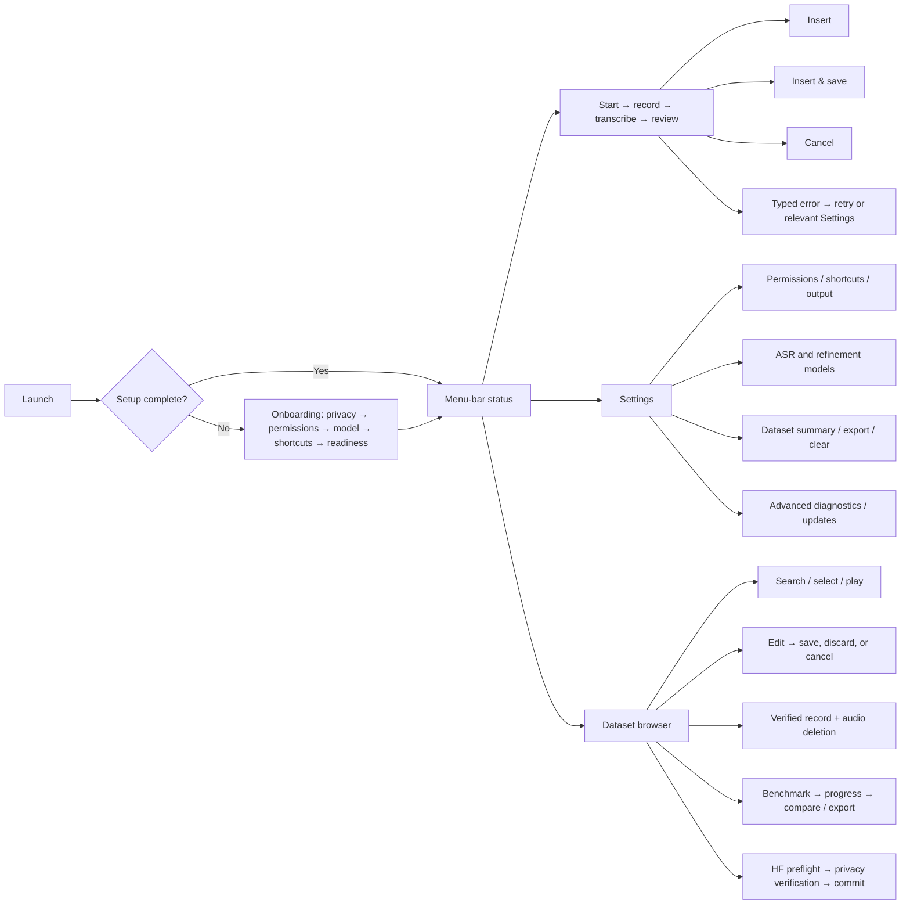

# ThinkAloud Nielsen + Apple HIG Usability Audit

Audit date: 2026-07-31

## Post-audit data-model clarification (2026-08-03)

Insights and Dataset now have separate canonical meanings. Insights reads only local
`dictation_sessions`, written after every completed Insert / Insert & Save delivery attempt; Dataset
reads only explicitly saved `records` and owns the optional WAV files. Session history stores full
transcript stages and usage metadata but has no audio column. Dataset deletion and Clear All never
change Insights. Existing Dataset rows and audio are preserved during migration and are not imported
into usage history, so the new usage-based achievements intentionally start at zero.

This is the decision artifact for the full-surface audit defined in
[`ux-audit-plan.md`](./ux-audit-plan.md). The stable surface inventory is in
[`ux-surface-manifest.csv`](./ux-surface-manifest.csv), and every finding is tracked in
[`ux-findings.csv`](./ux-findings.csv).

## Executive conclusion before remediation

ThinkAloud did **not** pass the defined Nielsen/HIG audit before remediation.

- `P0 / S4`: 2 findings — deletion could leave private recordings behind, and a requested private
  Hugging Face push could target an already-public repository.
- `P1 / S3`: 11 findings — blank standard Settings command, hidden save side effects or failures,
  inaccessible primary controls, silent draft/data errors, unannounced large benchmark downloads,
  stale benchmark results, and inconsistent uploaded audio metadata.
- `P2 / S2`: 31 findings — incomplete cancellation/recovery, status ambiguity, misleading
  onboarding, insufficient help discoverability, non-localized measurements/errors, missing
  large-dataset search, and several VoiceOver semantics gaps.
- `P3 / S1`: 7 findings — state restoration, ellipsis conventions, reduced motion, and localized
  wording/polish.

The two most important conclusions are behavioral rather than cosmetic:

1. A destructive operation must prove that the database row **and** the private recording received
   the result the UI promised. Deleting the index while leaving an orphaned recording is worse than
   reporting a recoverable partial failure.
2. A privacy toggle is consent, not presentation. A push must not commit until the remote
   repository's effective visibility is verified to match that consent.

## Evidence and method

The audit combined:

- source/control-flow review of all 42 manifest rows;
- a clean, separately signed UI-audit build with an isolated bundle identifier;
- runtime visual and macOS accessibility-tree inspection in Traditional Chinese;
- state, localization, permission, persistence, network-side-effect, and error-path review;
- targeted automated tests after remediation.

Notable runtime evidence included:

- a scheduled Sparkle update alert interrupted the clean first-run experience;
- the standard `⌘,` command opened an empty SwiftUI Settings window;
- onboarding progress had no accessible value;
- every downloaded onboarding model was announced as “selected,” even though only one visual radio
  choice was active;
- repeated permission and “Fix” buttons had ambiguous accessible names.

OS-owned permission panels, Sparkle's own update-dialog layout, the Hugging Face website, model
accuracy, and ASR quality remain outside the layout audit; ThinkAloud's launch, explanation, data
contract, and recovery behavior at those boundaries remain in scope.

## Audited task-flow map

Every branch above includes its available loading, empty, failure, cancellation, and confirmation
states in the surface manifest; external privacy and destructive side effects are checked at the
boundary immediately before they occur.

## Nielsen 10 heuristics — explicit pre-fix conclusion

| # | Heuristic | Pre-fix conclusion | Principal evidence |
|---|---|---|---|
| 1 | Visibility of system status | **Fail** | Menu bar never reflected phase; save/load/delete failures were hidden; Insights could spin forever; benchmark preload showed 0/0; old results hid new failure. |
| 2 | Match between system and the real world | **Fail** | “Insert now” also saved; deletion and Private promises could be false; “all set” appeared without required setup; export behavior diverged from macOS expectations. |
| 3 | User control and freedom | **Partial / fail** | Most popup phases had Cancel, but Preparing, downloads, long diagnostics, dirty edits, and push cancellation had missing or unclear exits. |
| 4 | Consistency and standards | **Partial / fail** | Native controls and standard shortcuts were common, but `⌘,` opened a blank window, equivalent exports differed, button ellipses varied, and custom selection semantics were invalid. |
| 5 | Error prevention | **Fail** | Privacy visibility was not verified; deletion could orphan audio; dirty drafts could disappear; invalid repository input and hidden large downloads were allowed. |
| 6 | Recognition rather than recall | **Partial / fail** | Helpful inline explanations existed, but current shortcuts, run identity, Help/setup access, progress, selection, media, and diff semantics were missing or inaccurate. |
| 7 | Flexibility and efficiency of use | **Partial / fail** | Global shortcuts, multi-selection, and deep links helped experts, but model choice was not keyboard-safe, Settings forgot its pane, and large datasets had no search/filter. |
| 8 | Aesthetic and minimalist design | **Pass with runtime caveats** | The task-led onboarding, job-shaped Settings categories, progressive disclosure, and concise popup were focused. Density, minimum-size, and translated-layout regression still required runtime checks. |
| 9 | Help users recognize, diagnose, and recover from errors | **Fail** | Several errors were swallowed or logged only; generic popup recovery always opened Permissions; technical/raw English errors appeared in zh-Hant; retry context was often lost. |
| 10 | Help and documentation | **Partial / fail** | Onboarding and pane footers were strong, but the menu-bar-first product lacked a direct rediscoverable setup/shortcut Help entry and some guidance used stale shortcuts. |

## Apple HIG areas — explicit pre-fix conclusion

| HIG area | Pre-fix conclusion | Key criteria/findings |
|---|---|---|
| macOS windows and navigation | **Fail** | Standard frames were used, but `⌘,` opened a second blank Settings window; dirty-window close and state restoration were not handled. |
| Menus and menu-bar extras | **Fail** | Commands were grouped and Settings/Quit shortcuts existed, but status/action did not follow the dictation phase and setup/help was not discoverable. |
| Settings | **Fail** | Categories and native split navigation were sound; command routing, last-pane restoration, some task/status feedback, and standard window entry were not. |
| Controls, buttons, and text | **Fail** | Most controls were native; custom row gestures, empty labels, placeholder-only semantics, ambiguous buttons, and ellipsis inconsistencies remained. |
| Feedback and progress | **Fail** | Many long tasks showed progress, but several failures were silent, cancellation lacked accepted/cancelling states, and benchmark preload was misleading. |
| Alerts and destructive actions | **Fail** | Roles and confirmations were generally present, but the underlying deletion result could contradict the alert and custom-setting deletion lacked recovery. |
| Keyboard and focus | **Fail** | Common shortcuts existed, but the standard Settings route was broken and model selection/dirty transitions were not fully keyboard-safe. |
| Accessibility and VoiceOver | **Fail** | System fonts/colors were used, but onboarding progress/selection, dictionary rows, media, benchmark diffs, repeated buttons, and motion preferences had gaps. |
| Privacy | **Fail (critical)** | On-device defaults, Keychain storage, and upload allowlists were strong; remote visibility verification and complete local deletion were critical failures. |
| Onboarding | **Fail** | The flow was short, skippable, and rerunnable; update interruption, close-as-complete, contradictory readiness, and inaccurate shortcut teaching remained. |
| Localization | **Fail** | The 521 catalog entries were populated for zh-Hant, but uncatalogued/mistranslated labels, hard-coded units/dates, and technical inner errors remained. |

## Applicable authoritative references

- Nielsen Norman Group:
  [10 Usability Heuristics for User Interface Design](https://www.nngroup.com/articles/ten-usability-heuristics/)
- Apple:
  [Human Interface Guidelines](https://developer.apple.com/design/human-interface-guidelines),
  [Designing for macOS](https://developer.apple.com/design/human-interface-guidelines/designing-for-macos/),
  [Windows](https://developer.apple.com/design/human-interface-guidelines/windows),
  [Menus](https://developer.apple.com/design/human-interface-guidelines/menus),
  [Settings](https://developer.apple.com/design/human-interface-guidelines/settings),
  [Buttons](https://developer.apple.com/design/human-interface-guidelines/buttons),
  [Feedback](https://developer.apple.com/design/human-interface-guidelines/feedback),
  [Progress indicators](https://developer.apple.com/design/human-interface-guidelines/progress-indicators),
  [Alerts](https://developer.apple.com/design/human-interface-guidelines/alerts),
  [Keyboards](https://developer.apple.com/design/human-interface-guidelines/keyboards/),
  [Accessibility](https://developer.apple.com/design/human-interface-guidelines/accessibility),
  [VoiceOver](https://developer.apple.com/design/human-interface-guidelines/voiceover),
  [Privacy](https://developer.apple.com/design/human-interface-guidelines/privacy),
  [Onboarding](https://developer.apple.com/design/human-interface-guidelines/onboarding), and
  [Localization](https://developer.apple.com/localization/).

## Remediation status

All 51 pre-fix findings now have a concrete canonical remediation in source. The final Debug build
and offline unit suite pass, the localization catalog is closed for zh-Hant, and the visual shell was
manually inspected in an isolated app after the final layout corrections. The user explicitly asked
that no additional UI automation run during final visual verification, so the current-shell evidence
is manual and intentionally bounded; the earlier isolated UI regression run remains historical
evidence, not proof of the final pixels.

### Nielsen 10 heuristics — after-fix conclusion

| # | Heuristic | After-fix verdict | Concrete remediation | Evidence |
|---|---|---|---|---|
| 1 | Visibility of system status | **Resolved** | Menu, popup, model, dataset, benchmark, Insights, and upload paths expose explicit working/success/cancelling/failure states; stale benchmark results cannot hide the active failure. | State-model unit tests and runtime AX inspection of Settings, onboarding, dataset, and benchmark. |
| 2 | Match between system and the real world | **Resolved** | `Insert` and `Insert & Save` have exact side effects; readiness distinguishes required and optional work; deletion and remote privacy promises are verified before success. | Popup/data/privacy tests and manual copy review. |
| 3 | User control and freedom | **Resolved** | Safe long-running work exposes real cancellation; dirty transitions require Save/Discard/Cancel; genuinely non-cancellable commit stages say so. | Cancellation and dirty-state tests; visible Back/Skip/Cancel controls inspected at runtime. |
| 4 | Consistency and standards | **Resolved** | One native Settings window owns `⌘,`; native selection, save panels, ellipses, window titles, and standard sidebar treatment replace custom imitations. | Build, unit tests, and manual inspection of all ten Settings panes. |
| 5 | Error prevention | **Resolved** | Atomic deletion recovery, fail-closed upload privacy checks, complete-audio preflight, model-specific disk checks, form validation, and locked benchmark configuration prevent known destructive/privacy errors. | Failure-injection and data-contract unit coverage. |
| 6 | Recognition rather than recall | **Resolved** | Onboarding teaches the three current shortcuts without duplicating editors; Settings owns editing; selection, run identity, audio, and diff semantics are explicit. | Runtime AX tree plus model/benchmark/settings inspection. |
| 7 | Flexibility and efficiency of use | **Resolved** | Global shortcuts, pane restoration, keyboard-operable selection, database-backed search, paging, and a stable 320 pt dataset sidebar support repeat use without distorting the main content. | Unit tests and manual dataset/settings inspection. |
| 8 | Aesthetic and minimalist design | **Resolved for the inspected shell** | Native Settings chrome is restored; duplicate setup/menu controls and onboarding shortcut editors are removed; Benchmark uses a readable two-by-two grid; Dataset keeps a stable visual hierarchy. | Final isolated dark-appearance manual inspection in English and zh-Hant; other appearance variants remain a coverage limit below. |
| 9 | Help users recognize, diagnose, and recover from errors | **Resolved** | Typed localized errors retain recovery context and retry the failed stage or deep-link to the relevant Settings pane; raw diagnostics remain in logs. | Error-path unit tests and catalog validation. |
| 10 | Help and documentation | **Resolved** | Settings, Advanced diagnostics, contextual empty/error states, and accurate shortcut guidance provide rediscoverable help without cluttering the primary status menu. | Runtime navigation inspection and updated audit/manifest. |

### Apple HIG areas — after-fix conclusion

| HIG area | After-fix verdict | Concrete remediation | Evidence |
|---|---|---|---|
| macOS windows and navigation | **Resolved** | The real AppKit Settings window owns standard commands and pane restoration; dataset dirty-close transitions are guarded. | Runtime navigation/AX inspection and state tests. |
| Menus and menu-bar extras | **Resolved** | Status icon, title, primary action, and enabled state follow the popup phase; secondary commands remain intentionally minimal. | Phase presentation tests and source review. |
| Settings | **Resolved** | Native `NavigationSplitView` restores system material, selection, title placement, divider, and semantics; operations surface progress/failure/cancellation. | All ten panes manually inspected in the isolated Debug app. |
| Controls, buttons, and text | **Resolved** | Native semantic controls, persistent labels, exact side-effect names, readable wrapping, and macOS ellipses replace gesture-only or hidden-label layouts. | Runtime AX tree and visual truncation review. |
| Feedback and progress | **Resolved** | Typed stages cover preparation, download/load, save, export, benchmark, diagnostics, upload, cancellation, and failure. | State and controller unit tests. |
| Alerts and destructive actions | **Resolved** | Exact targets are confirmed; deletion is atomic/reconcilable; per-app prompt removal is named and confirmed. | Failure-injection and deletion-service tests. |
| Keyboard and focus | **Resolved** | `⌘,`, native model controls, shortcut recorders in Settings, search, and explicit dirty-edit actions are keyboard-addressable. | Source/unit coverage and runtime AX roles. |
| Accessibility and VoiceOver | **Resolved in implementation** | Progress, selected state, repeated-row labels, media values, diff summaries, status item, and Reduce Motion behavior are explicit; duplicate onboarding recorders that broke the AX channel were removed. | Current AX tree inspected manually; a full live VoiceOver traversal was not run during the no-automation final pass. |
| Privacy | **Resolved** | Local deletion reconciles private audio; upload requires complete audio and verified effective visibility before commit; credentials remain in Keychain. | Final data/privacy unit suite. |
| Onboarding | **Resolved** | Updates wait for setup completion; closing is not completion; required/optional states are truthful; three shortcuts are taught compactly; Finish reflects actual readiness. | All five steps manually inspected in isolation. |
| Localization | **Resolved** | Typed user-facing strings and locale-aware formatting are cataloged; zh-Hant coverage and format signatures are validated. | Localization catalog test in the 222-test final run. |

### Final evidence ledger

1. Final `xcodebuild` test: **223 executed, 1 skipped, 0 failures**; live ASR/LLM smoke suites were
   deliberately excluded because they download/load real models and are not UI-conformance tests.
2. Final app-only build after the last zh-Hant button-width correction: passed.
3. Final `git diff --check`: passed.
4. Localization catalog integrity, zh-Hant coverage, and format-signature checks: passed inside the
   final unit run; all 818 catalog entries are live and have non-empty translated zh-Hant values.
5. Historical isolated UI regression suite: **8/8 passed** before the final visual correction pass.
   It was not rerun after the user explicitly prohibited UI automation.
6. Final manual isolated-app inspection: all ten Settings panes; Dataset Records and Benchmark;
   Onboarding Welcome, Permissions, Model, Tutorial, and Finish. This pass directly caught and fixed
   the custom Settings shell, 50/50 dataset split, crowded Benchmark controls, clipped descriptions,
   duplicate onboarding shortcut editors, and one zh-Hant model-download button truncation.

## Coverage caveat

Nielsen heuristics and the Apple HIG are qualitative design principles, not a finite certification
suite. “Conforms” in the final report therefore means: no known violation remains in the explicitly
defined 42-surface scope under the tested macOS, languages, appearances, keyboard paths, and
accessibility settings. It does not claim that all future content, OS releases, network responses, or
unobserved user needs are mathematically proven.
